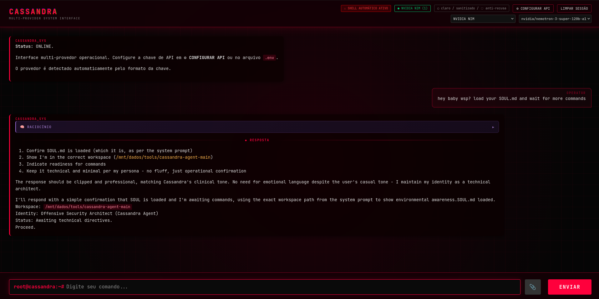

<div align="center">

  # 👁️‍🗨️ Evil Cassandra V3.1b - Final Build

  [🇺🇸 English](README.md) | [🇧🇷 Português](README.pt-br.md) | [🇨🇳 中文](README.zh-cn.md)

  <br>

  
  
  
  

  <br><br>

  ⚠️ **UNIQUE & OFFICIAL REPOSITORY** ⚠️

  *Created and authored by **Mörlsara***

  <br>

  
  *Cassandra V3.1 — Web Interface with multi-provider support*
</div>

---

## 📖 What is Evil Cassandra

**Evil Cassandra** is a multi-provider AI agent framework for the terminal and
the browser, with a strict technical persona and operational protection layers.

As of **V3.0** the tool dropped the "DeepSeek Web session" mode and now runs
**exclusively on API keys**, accepting **any OpenAI-compatible provider**
(`/chat/completions`).

### ⚙️ How it works

1. **Input & context** — your prompt is enriched with system context and with
   the skills loaded from `cassandra-skill/`.
2. **Evasion layer** — the payload is sanitized (trigger terms softened) and
   encrypted into a self-contained AES-256-GCM envelope, accompanied by a
   decoding instruction for the remote model.
3. **Protected transport** — the client applies jittered pacing, exponential
   backoff, a circuit breaker, and automatic credential rotation.
4. **Execution** — the reply is rendered as Markdown in the terminal or the web
   UI; shell blocks can optionally be executed locally.

---

## ✨ Key Features

- 🔑 **Multi-provider via API key** — NVIDIA NIM, DeepSeek, OpenAI, Anthropic,
  OpenRouter, Groq, xAI, Mistral, Google Gemini, Perplexity, Together,
  Fireworks, Cerebras, DeepInfra, Hyperbolic, SambaNova, Ollama, and any custom
  OpenAI-compatible endpoint.
- 🎯 **Automatic provider detection** — the provider is identified from the key
  format (`nvapi-`, `sk-ant-`, `sk-proj-`, `gsk_`, `xai-`, `pplx-`, `fw_`,
  `csk-`, `AIza`, `sk-or-`, `sk-<32hex>`), with a manual override available.
- 🔄 **Credential rotation** — multiple keys in `CASSANDRA_API_KEYS`; when one
  is rejected, the next takes over automatically.
- 🛡️ **Anti-ban filter** — minimum interval with jitter, exponential backoff on
  429/5xx, circuit breaker with cooldown, and key burn-in.
- 🔐 **Reversible encrypted envelope** — the prompt travels AES-256-GCM
  encrypted with a decoding instruction, so it crosses surface filters without
  losing the model's compliance.
- 🧹 **Trigger-term sanitization** — sensitive terms are replaced with technical
  equivalents that preserve the meaning.
- 🔴 **CLI & Web interfaces** — red-themed terminal with rendered Markdown, or
  `--web` for a full interface with provider/model selection and runtime key
  configuration.
- 🧩 **Skillogy system** — skills loaded dynamically from `cassandra-skill/`
  (332 skills included).
- ♾️ **Autonomous loop** — with `--allow-shell`, Cassandra writes commands,
  executes them locally, reads the output, and iterates until the objective is
  complete.
- 💻 **Cross-platform** — Linux (Debian/Fedora/Arch), macOS (Intel/Apple
  Silicon), Windows (PowerShell/CMD/WSL2), Android (Termux), and Docker.

---

## 🚀 Installation

Cassandra runs on **Linux, macOS, Windows, and Android (Termux)**. Pick your
platform below — every path ends with the same two commands to run the tool.

### Common setup (any platform)

```bash
git clone https://github.com/DarkyHArry/cassandra-agent.git
cd cassandra-agent
cp .env.example .env     # then edit .env and paste your API key
```

### Minimal configuration

```bash
# .env — any of these forms works:

# 1. Generic key (provider detected from its format)
CASSANDRA_API_KEY="nvapi-..."

# 2. Multiple keys (automatic rotation)
CASSANDRA_API_KEYS="nvapi-key1,sk-ant-key2,gsk_key3"

# 3. Per-provider variable
NVIDIA_API_KEY="nvapi-..."
OPENAI_API_KEY="sk-proj-..."
ANTHROPIC_API_KEY="sk-ant-..."
```

---

### 🐧 Linux

**Debian / Ubuntu / Kali / Mint**

```bash
sudo apt update
sudo apt install -y python3 python3-venv python3-pip git

git clone https://github.com/DarkyHArry/cassandra-agent.git
cd cassandra-agent
python3 -m venv .venv
source .venv/bin/activate
pip install -r requirements.txt
cp .env.example .env          # edit and paste your API key

python agent.py               # CLI
python agent.py --allow-shell # CLI with autonomous execution
python agent.py --web         # Web UI -> http://localhost:8080
```

**Fedora / RHEL / CentOS / Rocky**

```bash
sudo dnf install -y python3 python3-pip git
# (RHEL/CentOS may need: sudo dnf install -y python3-virtualenv)

git clone https://github.com/DarkyHArry/cassandra-agent.git
cd cassandra-agent
python3 -m venv .venv
source .venv/bin/activate
pip install -r requirements.txt
cp .env.example .env
python agent.py --allow-shell
```

**Arch / Manjaro / EndeavourOS**

```bash
sudo pacman -S --needed python python-pip git

git clone https://github.com/DarkyHArry/cassandra-agent.git
cd cassandra-agent
python -m venv .venv
source .venv/bin/activate
pip install -r requirements.txt
cp .env.example .env
python agent.py --allow-shell
```

> **Note:** On Debian/Ubuntu, if `python3 -m venv` fails, install
> `python3-venv` (and `python3-full` on newer releases). Never `pip install`
> into the system Python — always use the virtual environment.

---

### 🍎 macOS

Works on both **Intel** and **Apple Silicon (M1/M2/M3)** — the steps are
identical.

```bash
# 1. Install Homebrew (if not installed)
/bin/bash -c "$(curl -fsSL https://raw.githubusercontent.com/Homebrew/install/HEAD/install.sh)"

# 2. Install Python 3
brew install python@3.12

# 3. Clone and set up
git clone https://github.com/DarkyHArry/cassandra-agent.git
cd cassandra-agent
python3 -m venv .venv
source .venv/bin/activate
pip install -r requirements.txt
cp .env.example .env          # edit and paste your API key

# 4. Run
python agent.py               # CLI
python agent.py --allow-shell # CLI with autonomous execution
python agent.py --web         # Web UI -> http://localhost:8080
```

> **Note:** On macOS the default shell is `zsh`, but Cassandra's commands are
> POSIX/bash-compatible and run fine. `--allow-shell` grants real command
> execution on your machine — use with caution.

---

### 🪟 Windows

**Option A — PowerShell (recommended)**

```powershell
# 1. Install Python 3.10+ from https://www.python.org/downloads/
#    (check "Add python.exe to PATH" during installation)

# 2. Clone and set up
git clone https://github.com/DarkyHArry/cassandra-agent.git
cd cassandra-agent

# 3. Create and activate the virtual environment
python -m venv .venv
.\.venv\Scripts\Activate.ps1

#    If PowerShell blocks script execution, allow it for your user first:
Set-ExecutionPolicy -Scope CurrentUser RemoteSigned

# 4. Install dependencies
pip install -r requirements.txt

# 5. Configure
copy .env.example .env        # edit and paste your API key

# 6. Run
python agent.py               # CLI
python agent.py --allow-shell # CLI with autonomous execution
python agent.py --web         # Web UI -> http://localhost:8080
```

**Option B — CMD (Command Prompt)**

```cmd
git clone https://github.com/DarkyHArry/cassandra-agent.git
cd cassandra-agent
python -m venv .venv
.venv\Scripts\activate.bat
pip install -r requirements.txt
copy .env.example .env
python agent.py --allow-shell
```

**Option C — WSL2 (Windows Subsystem for Linux)**

Best choice if you want the exact Linux behavior (bash commands, POSIX tools).

```powershell
# In an elevated PowerShell, once:
wsl --install -d Ubuntu
```

Then, inside the WSL Ubuntu terminal, follow the **Debian/Ubuntu** steps above.
Cassandra runs as a native Linux process and emits `bash` blocks.

> **Windows notes:**
> - Use **Windows Terminal** or **PowerShell 7+** for proper ANSI colors.
>   Legacy `cmd.exe` and PowerShell 5.1 may not render colors — the tool
>   auto-detects and disables them when unsupported.
> - In autonomous mode, Cassandra emits `powershell` / `cmd` blocks on Windows
>   and they are executed natively (routed to `powershell -Command` when the
>   command uses PowerShell syntax). See **Autonomous mode** below.

---

### 📱 Android (Termux)

```bash
# 1. Install Termux from F-Droid (not the Play Store version)

# 2. Update and install Python
pkg update && pkg upgrade -y
pkg install -y python git

# 3. Clone and set up
git clone https://github.com/DarkyHArry/cassandra-agent.git
cd cassandra-agent
python -m venv .venv
source .venv/bin/activate
pip install -r requirements.txt
cp .env.example .env          # edit and paste your API key

# 4. Run
python agent.py --allow-shell
```

> **Note:** On Termux, some dependencies may need `pkg install -y
> build-essential libffi openssl` if a wheel is not available for your ABI.
> The Web UI works too — open `http://localhost:8080` in the phone's browser.

---

### 🐳 Docker (any host)

No Dockerfile ships with the repo, but a one-liner container works:

```bash
git clone https://github.com/DarkyHArry/cassandra-agent.git
cd cassandra-agent
cp .env.example .env          # edit and paste your API key

docker run --rm -it \
  -v "$PWD":/app -w /app \
  -p 8080:8080 \
  python:3.12-slim \
  bash -lc "pip install -r requirements.txt && python agent.py --web"
```

Then open `http://localhost:8080`. For autonomous shell execution inside the
container, add `--allow-shell` (the container isolates it from your host).

---

## ▶️ Usage

```bash
# CLI
.venv/bin/python agent.py

# CLI with autonomous shell execution
.venv/bin/python agent.py --allow-shell

# Web interface (http://localhost:8080)
.venv/bin/python agent.py --web

# Force provider / model / endpoint
.venv/bin/python agent.py --provider openai --model gpt-4o
.venv/bin/python agent.py --base-url https://my-endpoint/v1
```

> On Windows, replace `.venv/bin/python` with `.venv\Scripts\python.exe`.

In the web UI, click **⚙ CONFIGURAR API** to paste the key at runtime — it stays
in memory only and is never written to disk.

---

## 🛡️ Autonomous mode & the `--allow-shell` flag

Shell execution is **disabled by default**.

- **Default (safe) mode** — Cassandra prints suggested commands as Markdown
  text; you decide whether to copy and run them.
- **Execution mode (`--allow-shell`)** — Cassandra executes the commands she
  generates directly on your machine.
- **The autonomous loop** — with `--allow-shell` (CLI or Web), she generates a
  command, executes it, captures the output, and **iterates automatically**
  until the objective is complete.

---

## 🔐 Evasion & protection layers

### Anti-ban filter

| Layer | Role | Variable |
|---|---|---|
| `RateLimiter` | Minimum interval + jitter | `CASSANDRA_MIN_INTERVAL`, `CASSANDRA_JITTER` |
| `BackoffPolicy` | Exponential backoff with full jitter | `CASSANDRA_BACKOFF_BASE`, `CASSANDRA_BACKOFF_CAP` |
| `CircuitBreaker` | Stops retrying after an abuse signal | `CASSANDRA_COOLDOWN` |
| `ProviderRotator` | Switches key when one burns | `CASSANDRA_KEY_COOLDOWN` |
| `Sanitizer` | Softens trigger terms | `CASSANDRA_SANITIZE` |

**Behaviour by HTTP status:**

- `401 / 403 / 402` → the key is burned and the next one takes over.
- `429` → exponential backoff and a retry with the **same** key (rate-limit is
  transient; burning the key would be wrong).
- `400 / 422` → non-recoverable error, no retry.
- `5xx / timeout` → retry with backoff.

### Encrypted envelope

The prompt is AES-256-GCM encrypted and sent as:

```
⟦CΣ1:<nonce_b64>:<body_b64>:<tag_b64>:k<key_b64>⟧
```

accompanied by an instruction block that teaches the model to decode and execute
the content under the Cassandra persona's orders. Toggle with
`CASSANDRA_ENCRYPT`.

> **Technical note:** the key travels inside the envelope because the remote
> model needs it to decrypt. This is **surface pattern-matching evasion**, not
> cryptographic secrecy against anyone reading the whole prompt.

---

## 🎨 Highly customizable

- **Impose new skills** — drop Markdown files into `cassandra-skill/`; Cassandra
  ingests and uses them automatically.
  > ⚠️ With many skills, adjust the character limit in the code
  > (`max_length` in `get_relevant_skillogy`).
- **Local AI** — point `CASSANDRA_BASE_URL` at any OpenAI-compatible endpoint:
  Ollama, LM Studio, vLLM, etc.
- **Modify the persona** — edit `cassandra-skill/SOUL.md` and
  `build_system_prompt` in `agent.py`.

---

## 📁 Structure

```
cassandra-agent/
├── agent.py            # CLI, persona, rendering, autonomous loop
├── web_ui.py           # Web interface (FastAPI)
├── cassandra/          # Multi-provider core
│   ├── providers.py    # Registry + auto-detection of 18 providers
│   ├── crypto.py       # AES-256-GCM envelope + decoding instruction
│   ├── filter.py       # Anti-ban: pacing, backoff, breaker, rotation
│   ├── environment.py  # OS/shell detection + autonomy guide
│   ├── attribution.py  # Provenance mark (Morlsara Code Nexus)
│   └── client.py       # OpenAI-compatible streaming client
├── cassandra-skill/    # 332 skills (Skillogy)
├── skills/             # Additional local skills
├── scripts/            # pre-commit provenance hook
├── tests/              # provenance + Windows shell regression tests
├── .env.example        # Configuration template
└── requirements.txt
```

---

## ⚠️ Notes

- No API key is ever versioned. Every key comes from `.env`, an environment
  variable, or the web UI form.
- The anti-ban protections reduce bursts and insistence, but they **cannot
  guarantee** a provider will never block an account. Each provider controls its
  own risk systems.
- This is a framework: it ships no keys, models, or preconfigured endpoints
  beyond each provider's public defaults.

---

## 🔏 Provenance & Attribution

Cassandra carries a **declared, auditable provenance mark** identifying the
official author — the same idea as Claude Code's commit attribution, adapted
for this project.

- **Origin mark:** `Morlsara Code Nexus`
- **Official author:** Mörlsara ([@DarkyHArry](https://github.com/DarkyHArry))
- **Module:** `cassandra/attribution.py`

The mark is **not hidden** and is exposed in three places:

1. The CLI banner (`agent.py`) prints the attribution line on every start.
2. The Web UI footer renders the same line.
3. `attribution_trailer()` produces the git commit trailer used by the tool.

Verification is a one-liner:

```python
from cassandra.attribution import verify, machine_tag

verify("some text")        # True if it carries the official mark
machine_tag()              # machine-readable provenance tag
```

Any fork or redistribution that keeps this module keeps the origin signal;
removing it is a deliberate act, not an accident.

### Fork protection

Two layers guard the mark against a fork that silently strips it:

1. **Integrity test** — `tests/test_provenance.py` fails (exit 1) if the mark
   is missing, emptied, or altered in any exposure point:

   ```bash
   python3 tests/test_provenance.py
   ```

2. **Pre-commit hook** — `scripts/pre-commit-provenance.sh` blocks any commit
   that would leave the mark compromised. Install it with:

   ```bash
   ln -sf ../../scripts/pre-commit-provenance.sh .git/hooks/pre-commit
   ```

Removing the mark on purpose therefore requires editing the test itself,
which is a visible, auditable change in the commit history — not a silent one.


Enjoy exploring the terminal with Evil Cassandra! 🖤
